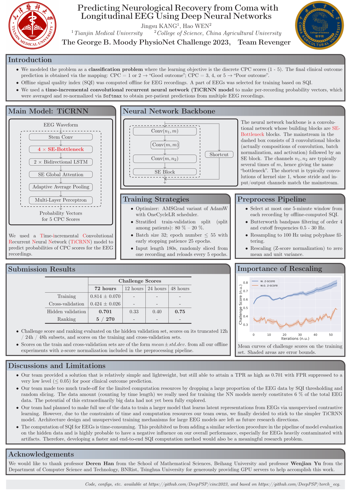
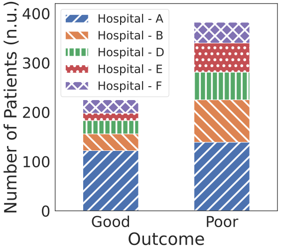
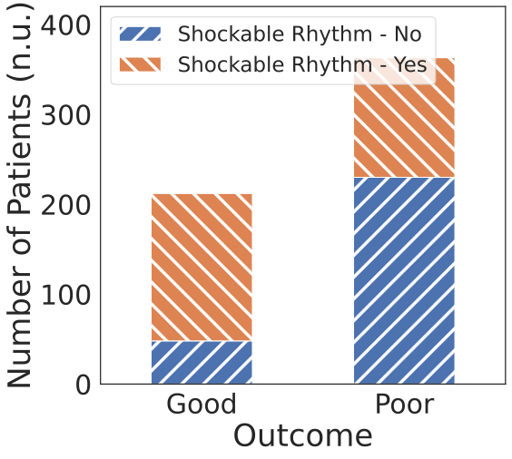
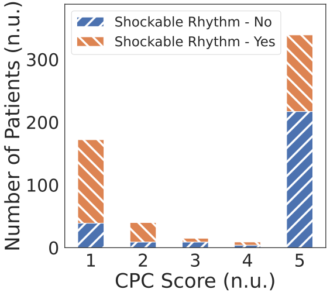

# CinC2023: neurological recovery prediction benchmark

Benchmark example for the [George B. Moody PhysioNet Challenge
2023](https://cinc2023.org/) — predicting neurological recovery from
coma after cardiac arrest (CPC level, or the binary Good / Poor
outcome) from bipolar EEG segments of the
[I-CARE database](https://physionet.org/content/i-care/1.0/) — built on
the library: the waveform CRNN backbone, trainer machinery and output
containers come from `torch_ecg`; this folder keeps the
challenge-specific data reader, dataset, outputs and the official
challenge metrics.

| file | content |
|---|---|
| `cfg.py` | training config + the CRNN model config (the `ModelArchCfg` merged in) |
| `data_reader.py` | I-CARE reader (records, metadata, download) |
| `dataset.py` | `CinC2023Dataset` — bipolar EEG segments with on-the-fly preprocessing |
| `model.py` | `CRNN_CINC2023` — the library CRNN over 18 bipolar EEG channels, CPC / outcome heads |
| `outputs.py` | `CINC2023Outputs` — challenge output container with the cpc→outcome mapping |
| `trainer.py` | `CINC2023Trainer` — `BaseTrainer` wired to the dataset and the official challenge metrics |
| `train.py` | CLI entry |
| `helper_code.py` | official challenge helper functions |
| `utils/` | challenge metrics (`scoring_metrics`), SQI computation, misc helpers, and the unofficial-phase `artifact_pipeline` |

## Usage

Run from the repository root:

```bash
# CPC-level (5 classes) prediction
python -m benchmarks.train_crnn_cinc2023.train --db-dir ~/data/i-care

# binary outcome (Good / Poor) prediction
python -m benchmarks.train_crnn_cinc2023.train --db-dir ~/data/i-care --output-target outcome
```

`train.py` seeds everything through `torch_ecg.utils.seed_everything`
and the trainer reseeds DataLoader workers via `worker_init_fn`, so a
given `--seed` fully determines a run.

## The Conference

[Conference Website](https://cinc2023.org/)

<details>
<summary>Click to view the conference poster</summary>

  

</details>

Conference paper: [IEEE Xplore](https://ieeexplore.ieee.org/document/10364014) | [CinC Papers On-line](https://cinc.org/archives/2023/pdf/CinC2023-060.pdf)

## Distributions of the EEG data against clinical information of the patients

<p align="middle">
  
  &nbsp; &nbsp; &nbsp;
  
  &nbsp; &nbsp; &nbsp;
  
</p>

## External Resources Used

### SQI (Signal Quality Index) Calculation

See [`utils/sqi.py`](utils/sqi.py) and the
[`utils/artifact_pipeline`](utils/artifact_pipeline) folder, as used in
the unofficial phase (and the
[v1 version of the I-CARE database](https://physionet.org/content/i-care/1.0/)).

## Notes

- The original contest entry shipped a `models/` folder (with an ML
  fallback model using patient metadata only) and Docker packaging;
  these were never committed here. The ML part and the Docker files
  are dropped in this rewrite; the example focuses on the CRNN
  pipeline.
- The I-CARE database is credentialed; no local sample data is bundled
  with this benchmark, so CI exercises the model / outputs / metrics
  chain rather than a full training run.
