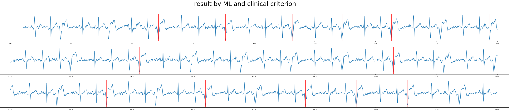
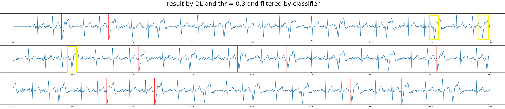
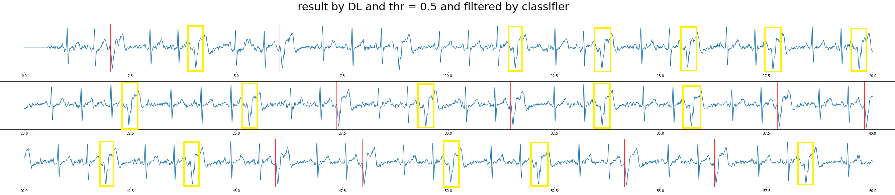
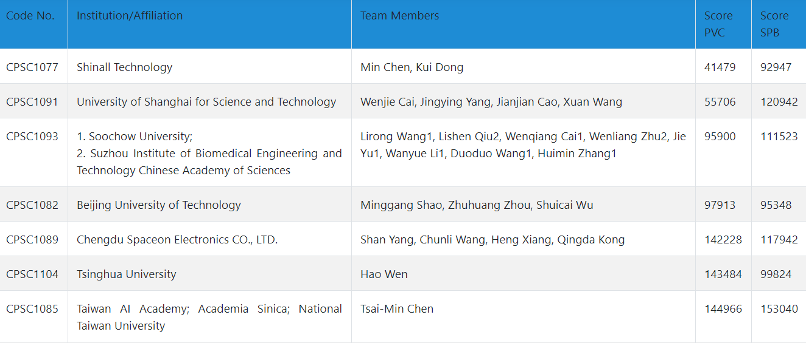

# CPSC2020: premature beat detection benchmark

Benchmark example for the [3rd China Physiological Signal Challenge
2020](http://www.icbeb.org/CSPC2020) — searching for premature
ventricular contractions (PVC) and supraventricular premature beats
(SPB) from long-term single-lead ECGs — built on the library: the
reader and the official challenge score come from `torch_ecg`
(`torch_ecg.databases.CPSC2020` and
`torch_ecg.databases.cpsc_databases.cpsc2020.compute_metrics`);
this folder keeps the challenge-specific dataset, models and metrics.

Two model families:

- `crnn` — segment-level classification (N / S / V), `ECG_CRNN` with
  a multi-scopic CNN, evaluated by the official AUROC / AUPRC /
  accuracy / F-measure / F-beta / G-beta measures;
- `seq_lab` — beat-level sequence labelling (S / V localization),
  `ECG_SEQ_LAB_NET`, evaluated by the official challenge score.

| file | content |
|---|---|
| `cfg.py` | training config + the two model configs (hand-tuned multi-scopic CNN) |
| `dataset.py` | `CPSC2020` dataset: slices records into 10 s segments with overlap around premature beats, on-the-fly augmentations |
| `model.py` | `ECG_CRNN_CPSC2020` and `ECG_SEQ_LAB_NET_CPSC2020` with SPB/PVC inference |
| `metrics.py` | official classification metrics for the `crnn` branch |
| `signal_processing/` | `ecg_denoise` helper used to drop flat / motion-artefact segments |
| `trainer.py` | `CPSC2020Trainer` — `BaseTrainer` wired to the dataset, one branch per model family |
| `train.py` | CLI entry |

## Usage

Run from the repository root:

```bash
# segment-level classification model
python -m benchmarks.train_hybrid_cpsc2020.train --db-dir ~/data/cpsc2020

# beat-level sequence labelling model
python -m benchmarks.train_hybrid_cpsc2020.train --db-dir ~/data/cpsc2020 --model-name seq_lab
```

`train.py` seeds everything through `torch_ecg.utils.seed_everything`
and the trainer reseeds DataLoader workers via `worker_init_fn`, so a
given `--seed` fully determines a run. On first use the records are
sliced into segments offline (`CPSC2020.persistence()`, idempotent).

## Notes from the original contest entry (2020)

Tests on a 60s segment of a subject with frequent PVC (updated on
2020/12/31):

* PVC beats are labeled using red vertical lines; missed PVC beats
  are labeled using yellow boxes.
* the first image is the result by a modified version of machine
  learning algorithms (XGBoost with RR features and wavelet features);
* the second / third images are results of the sequence labelling
  model with probability threshold 0.3 / 0.5, filtered by a
  classifier.





Observations:

* an effective and robust rpeak (qrs complex) detector is crucial;
* the sequence labelling model tends to make false positive
  predictions but seldom has false negatives; lowering its threshold
  from 0.5 to 0.3 largely reduces the challenge penalty (false
  negatives are punished 5 times as heavily as false positives);
* given a good rpeak detector, machine learning models might well be
  competitive against deep learning models.

## Evaluation result

[Evaluation result](http://www.icbeb.org/CSPC2020) on the final full
hidden test set (not fully listed)



## References

1. [ecg-classification](https://github.com/mondejar/ecg-classification)
2. [BioSPPy](https://github.com/PIA-Group/BioSPPy)
