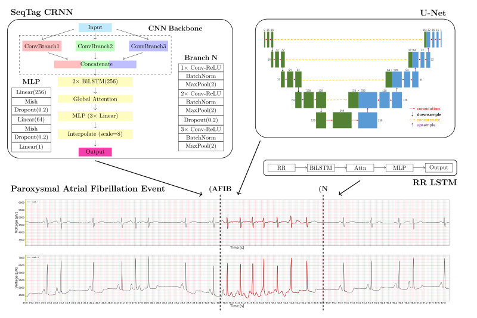
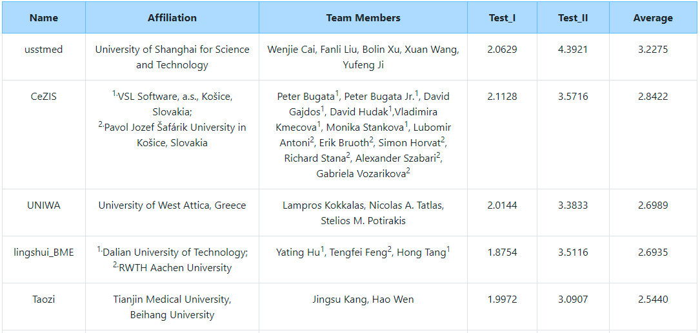
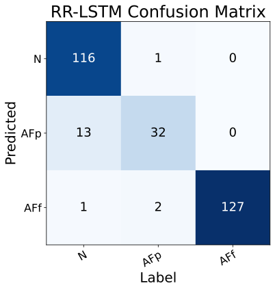
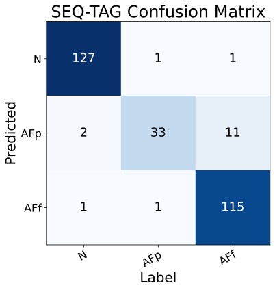
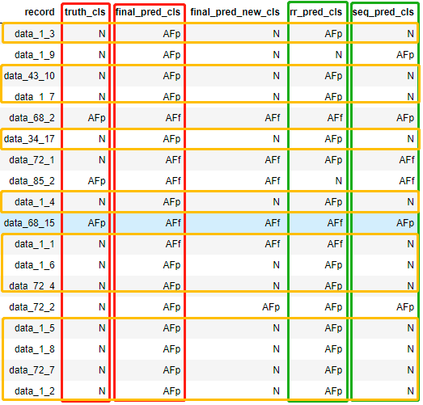
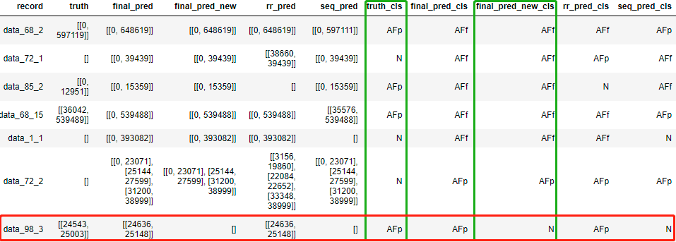

# CPSC2021: hybrid benchmark (paroxysmal AF event detection)

Benchmark example for the [4th China Physiological Signal Challenge
2021](http://2021.icbeb.org/CPSC2021) — paroxysmal atrial fibrillation
(AF) event detection from long-term dynamic ECG recordings — built
directly on the library: the reader, dataset, trainer machinery,
backbones and the official challenge score all come from `torch_ecg`
(`CPSC2021Dataset`, `ECG_SEQ_LAB_NET` / `ECG_UNET` / `RR_LSTM` and
`torch_ecg.databases.cpsc_databases.cpsc2021.compute_metrics`); this
folder only contains what is specific to the challenge.

The solution is a 3-task pipeline:

1. `qrs_detection` — R-peak detection by sequence labelling (or U-Net),
   scored with the CPSC2019 challenge metric;
2. `rr_lstm` — AF classification on RR-interval sequences by `RR_LSTM`
   (optionally with a CRF layer);
3. `main` — direct AF-episode segmentation of the ECG by sequence
   labelling (or U-Net), evaluated by the challenge-imitating
   `main_score` (see `aux_metrics.py`).

| file | content |
|---|---|
| `cfg.py` | training config (inherited from `CPSC2021TrainCfg`) + per-task model configs |
| `model.py` | the four challenge models with task-specific inference (R peaks / AF episodes) |
| `trainer.py` | `CPSC2021Trainer` — `BaseTrainer` wired to `CPSC2021Dataset`, one branch per task |
| `aux_metrics.py` | challenge-imitating scores for the `rr_lstm` and `main` tasks |
| `train.py` | CLI entry |

## Usage

Run from the repository root:

```bash
# train the full pipeline (all three tasks in sequence)
python -m benchmarks.train_hybrid_cpsc2021.train --db-dir ~/data/cpsc2021

# train a single task, with a non-default architecture
python -m benchmarks.train_hybrid_cpsc2021.train --db-dir ~/data/cpsc2021 --task main --model-name unet

# quick end-to-end check (2 epochs, debug logging)
python -m benchmarks.train_hybrid_cpsc2021.train --db-dir <path> --task qrs_detection --smoke
```

`train.py` seeds everything through `torch_ecg.utils.seed_everything`
and the trainer reseeds DataLoader workers via `worker_init_fn`, so a
given `--seed` fully determines a run.

## Data

- original challenge data: see the [challenge website](http://2021.icbeb.org/CPSC2021);
- `train.py` prepares the training data offline on first use
  (bandpass filtering, slicing into 30 s segments around AF transitions,
  RR-interval sequences) via `CPSC2021Dataset.persistence()`, which is
  idempotent and skipped when already done;
- the same sliced data is also distributed as
  [CPSC2021-sliced](https://www.kaggle.com/wenh06/cpsc2021-sliced) on Kaggle.

## Graphical abstract of the solution



## Results (rankings, original contest entry)

### Results on the full hidden test set (only the top 5 of the official entries are included)



Check the [official website](http://2021.icbeb.org/CPSC2021) for the full list.

### Results on the validation set

Raw results are gathered into one zip file, the `val_res.zip` in the [`results`](results/) folder

|     Network(s)    | Merge Rule    | Score on Partial Hidden Test Set | Score on Validation Set|
|-------------------|---------------|----------------------------------|------------------------|
|   LSTM            |  NA           |   1.9392                         | 2.0621                 |
|   SeqTag          |  NA           |   1.9781                         | 2.1577                 |
|   U-Net           |  NA           |   1.3699                         | NA                     |
|  LSTM + U-Net     |  Union        |   1.7829                         | NA                     |
|  LSTM + SeqTag    |  Intersection |   1.9287                         | NA                     |
|  LSTM + SeqTag    |  Union        |   1.9766                         | 2.1682                 |
| **LSTM + SeqTag** | **New Union** |   **1.9972**                     | **2.2179**             |

### Confusion matrices of the LSTM model and the SeqTag model on the validation set

<p align="middle">
  
  &nbsp; &nbsp; &nbsp; &nbsp;&nbsp; &nbsp; &nbsp; &nbsp;
  
</p>

### More detailed analysis using `pandas` on the validation set

<p align="middle">
  
  
</p>

## References

1. <http://2021.icbeb.org/CPSC2021>
