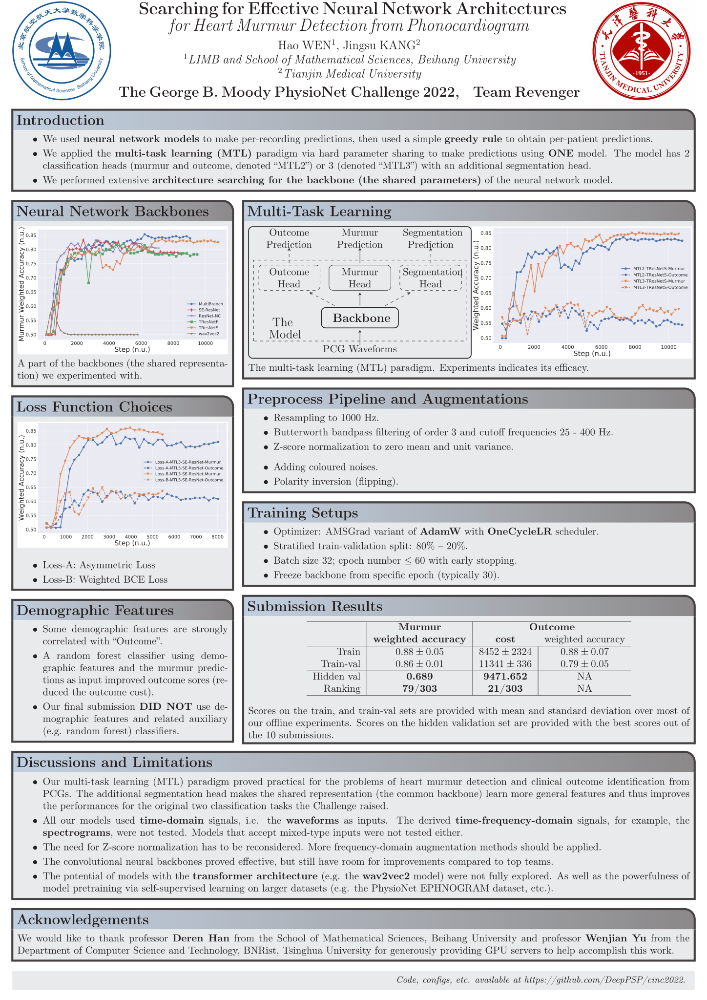

# CinC2022: heart murmur detection benchmark (MTL)

Benchmark example for the [George B. Moody PhysioNet Challenge
2022](https://physionetchallenges.org/2022/) — heart murmur detection
from phonocardiogram (PCG) recordings of the Circulatory Sounds
database — built on the library: the CRNN / sequence-labelling /
U-Net backbones, trainer machinery and output containers come from
`torch_ecg`; this folder keeps the challenge-specific data reader,
dataset, audio inputs and augmentations (torch_audiomentations), the
multi-task heads, the official challenge metrics, and two wav2vec2
pretraining subprojects for PCG.

Three training tasks:

- `classification` — murmur classification (with an optional clinical
  outcome head), CRNN or wav2vec2 backbones;
- `segmentation` — heart-state sequence segmentation (S1, systole,
  S2, diastole), sequence labelling or U-Net;
- `multi_task` — the CRNN with murmur, outcome and segmentation heads
  trained jointly.

| file / folder | content |
|---|---|
| `cfg.py`, `cfg_models.py` | training config + per-task model configs |
| `data_reader.py` | Circulatory Sounds reader (records, metadata, download) |
| `dataset.py` | `CinC2022Dataset` with on-the-fly preprocessing and augmentations |
| `inputs.py` | input configurations (waveform / spectrogram / mel / MFCC) |
| `models/` | `CRNN_CINC2022` (+ heads), `SEQ_LAB_NET_CINC2022`, `UNET_CINC2022`, `Wav2Vec2_CINC2022` (two implementations) |
| `outputs.py` | `CINC2022Outputs` — murmur / outcome / segmentation output container |
| `trainer.py` | `CINC2022Trainer` — `BaseTrainer` wired to the dataset and the official challenge metrics |
| `train.py` | CLI entry |
| `utils/` | challenge metrics (`scoring_metrics`), audio augmentations, Springer PCG features, plotting, murmur knowledge base |
| `wav2vec2_hf/`, `wav2vec2_ta/` | wav2vec2 pretraining on PCG (HuggingFace and torch-audio implementations) |

## Usage

Run from the repository root:

```bash
# murmur classification task
python -m benchmarks.train_mtl_cinc2022.train --db-dir ~/data/circulatory-sounds --task classification

# heart-state segmentation, with the U-Net model
python -m benchmarks.train_mtl_cinc2022.train --db-dir ~/data/circulatory-sounds --task segmentation --model-name unet

# the multi-task model (all heads)
python -m benchmarks.train_mtl_cinc2022.train --db-dir ~/data/circulatory-sounds --task multi_task
```

`train.py` seeds everything through `torch_ecg.utils.seed_everything`
and the trainer reseeds DataLoader workers via `worker_init_fn`, so a
given `--seed` fully determines a run.

## Knowledge about Heart Murmur

[utils/HeartMurmur.md](utils/HeartMurmur.md) contains knowledge about
heart murmur collected from various sources.

## The Conference

[Conference Website](https://events.tuni.fi/cinc2022/) | [Conference Program](https://cinc.org/prelim_program_2022/)

[Preprint](https://cinc.org/2022/Program/accepted/130_Preprint.pdf)

<details>
<summary>Click to view the conference poster</summary>



</details>

## Final Scores

Final scores are released in [https://physionetchallenges.org/2022/results/](https://physionetchallenges.org/2022/results/) in 5 `.tsv` files.

These files were gathered in one [`.xlsx` file](results/final_scores.xlsx),
which was uploaded into [Google Sheets](https://docs.google.com/spreadsheets/d/17RPPzMTV9WW0QHToIvFEfhHw47LYx3LgQZxJSeDElzg/edit?usp=sharing).

<details>
<summary>Click to expand!</summary>

One can load the 5 tables all at once via

```python
pd.read_excel("./results/final_scores.xlsx", engine="openpyxl", sheet_name=None)
```

One can get a digest of the scores and rankings of all metrics (Weighted Accuracy, Cost, etc.) for the murmur task and the outcome task via

```python
from utils._final_results import get_team_digest

get_team_digest("Revenger", fmt="pd", latest=True)  # pandas DataFrame format
get_team_digest("Revenger", fmt="tex", latest=True)  # latex format (string)
```

</details>

## Top Team Papers

<details>
<summary>Click to view!</summary>

- [CUED_Acoustics](https://cinc.org/2022/Program/accepted/20_Preprint.pdf)
- [HearHeart](https://cinc.org/2022/Program/accepted/165_Preprint.pdf)
- [HearTech](https://cinc.org/2022/Program/accepted/439_Preprint.pdf)
- [prna](https://cinc.org/2022/Program/accepted/309_Preprint.pdf)
- [CeZIS](https://cinc.org/2022/Program/accepted/67_Preprint.pdf)
- [CAU_UMN](https://cinc.org/2022/Program/accepted/71_Preprint.pdf)
- [Melbourne Kangas](https://cinc.org/2022/Program/accepted/310_Preprint.pdf)

</details>

## Official Phase Leaderboards

[Murmur](https://docs.google.com/spreadsheets/u/0/d/e/2PACX-1vRNBATogMRsfio3938bU4r6fcAad85jNzTbSRtRhQ74xHw9shuYoP4uxkK6uKV1zw8CKjPC3AMm33qn/pubhtml/sheet?headers=false&gid=0)

[Outcome](https://docs.google.com/spreadsheets/u/0/d/e/2PACX-1vRNBATogMRsfio3938bU4r6fcAad85jNzTbSRtRhQ74xHw9shuYoP4uxkK6uKV1zw8CKjPC3AMm33qn/pubhtml/sheet?headers=false&gid=1883863848)

## Notes

- The original contest entry (`team_code.py`, the Docker packaging and
  its entry test, and the metadata-only ML outcome model) is dropped
  in this rewrite; the example focuses on the DL pipelines.
- [`pcg_springer_features`](https://github.com/DeepPSP/pcg_springer_features)
  re-implements the feature extraction part of
  [David Springer's logistic regression-HSMM-based heart sound
  segmentation algorithm](https://physionet.org/content/hss/1.0/);
  a copy lives inside [utils](utils).
